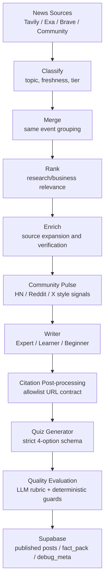

# 0to1log AI Engineering Portfolio

> 목적: 이 문서는 0to1log 프로젝트를 **AI 엔지니어 포트폴리오** 관점에서 설명하기 위한 별도 요약본이다. 전체 프로젝트 설명은 `docs/0to1log-project-report.ko.md`를, 파이프라인 개선 여정은 `docs/portfolio/pipeline-journey.ko.md`를 참고한다.

## 1. 한 줄 포지셔닝

0to1log는 매일 50~60개의 AI 뉴스를 수집해 중복 이벤트를 병합하고, Research/Business 관점으로 분류한 뒤, Expert/Learner/Beginner 독자층에 맞춘 한영 뉴스 다이제스트와 퀴즈를 생성하는 **LLM 기반 뉴스 큐레이션 파이프라인**이다.

이 프로젝트에서 AI 엔지니어링 관점으로 가장 강하게 어필할 수 있는 포인트는 단순히 "LLM으로 글을 생성했다"가 아니다. 핵심은 다음과 같다.

- LLM을 단일 생성기가 아니라 **분류, 병합, 랭킹, 검증, 집필, 퀴즈 생성, 품질 평가**로 분해된 파이프라인 구성 요소로 운영했다.
- 프롬프트 의존도를 줄이고 **strict JSON schema, URL enum, deterministic guardrail, Pydantic 모델**로 출력 계약을 강제했다.
- hallucination, citation drift, 비용 폭증, retry storm, 소스 품질 저하 같은 운영형 문제를 실제 로그와 커밋 단위로 추적하며 개선했다.
- 품질과 비용을 같이 다루기 위해 **service tier, prompt cache, usage/cost telemetry, failed-call cost estimation, stage rerun**을 구현했다.
- Expert/Learner/Beginner 페르소나와 한영 콘텐츠를 별도 생성/검증 대상으로 다루며, AI 기능을 제품 경험으로 연결했다.

## 2. 프로젝트 스냅샷

| 항목 | 내용 |
| --- | --- |
| 프로젝트 | 0to1log |
| 역할 | Solo full-stack / AI engineering / product design |
| 도메인 | AI 뉴스 큐레이션, 학습형 뉴스, 커뮤니티 인사이트 |
| 주요 스택 | FastAPI, Astro, Supabase(PostgreSQL/Auth/RLS), OpenAI, PydanticAI, Tavily, Exa, Brave |
| AI 파이프라인 | 수집 -> 분류 -> 병합 -> 랭킹 -> 소스 보강 -> 커뮤니티 분석 -> 다이제스트 생성 -> 퀴즈 생성 -> 품질 평가 -> 발행 |
| 콘텐츠 단위 | Daily / Weekly, Research / Business, Expert / Learner / Beginner, EN / KO |
| 대표 성과 | v2~v13에 걸쳐 비용, 품질, citation, source quality, rerun reliability를 단계적으로 개선 |

## 3. AI 엔지니어링 문제 정의

0to1log의 AI 문제는 "뉴스를 요약하는 챗봇" 문제가 아니라, 매일 반복 실행되는 editorial pipeline을 안정적으로 운영하는 문제에 가깝다. 실제로 다룬 문제는 다음과 같다.

| 문제 | 단순 접근의 한계 | 0to1log에서의 대응 |
| --- | --- | --- |
| 중복 뉴스 | 같은 사건을 여러 출처가 반복 보도 | topic/entity 기반 merge, ranked group 처리 |
| 소스 품질 | PR/미러/SEO 스팸이 생성 품질을 망침 | freshness/tier gate, blocklist, source quality guard |
| URL hallucination | LLM이 없는 링크를 만들어냄 | writer schema의 `citations[].url`을 allowlist enum으로 제한 |
| 인용 부족 | 문단은 그럴듯하지만 근거가 약함 | citation density, paragraph coverage, citation post-processing |
| 비용 폭증 | reasoning model, retry, enrichment가 비용을 키움 | flex tier, prompt cache, stage rerun, failed-call usage estimation |
| 재실행 비용 | 일부 단계 실패 시 전체 파이프라인 재실행 필요 | `STAGE_CASCADE`, quiz-only rerun, quality-only rerun |
| 다국어/페르소나 품질 | EN/KO, Expert/Learner/Beginner가 같은 기준으로 생성되면 부자연스러움 | persona별 writer output, locale guard, beginner-specific checks |
| 운영 관측성 | "왜 비싸졌는지", "어디서 실패했는지" 설명 어려움 | usage metrics, service tier tracking, debug_meta, per-attempt timeline |

## 4. 시스템 구조

이 구조에서 중요한 점은 모든 단계를 하나의 거대한 프롬프트로 처리하지 않았다는 것이다. 각 단계가 별도 입력/출력 계약을 갖고, 일부 단계만 재실행할 수 있으며, 실패와 비용을 단계 단위로 추적한다.

## 5. 핵심 AI 엔지니어링 역량

### 5.1 LLM 오케스트레이션: 하나의 모델 호출을 제품 파이프라인으로 분해

0to1log의 파이프라인은 LLM 호출을 역할별로 분리한다.

- `classify`: 뉴스 후보를 Research/Business 관점과 freshness/tier 기준으로 분류한다.
- `merge`: 여러 출처가 다룬 동일 사건을 하나의 이벤트 그룹으로 묶는다.
- `rank`: 발행 가치와 독자 적합도를 기준으로 우선순위를 정한다.
- `enrich`: 부족한 소스를 보강하고, 고품질 소스만 writer에 넘긴다.
- `community`: Hacker News, Reddit 등 커뮤니티 반응을 별도 provenance로 정리한다.
- `write`: Expert/Learner/Beginner 페르소나별 다이제스트를 생성한다.
- `quiz`: 본문 생성과 분리된 퀴즈 생성 단계로 운영한다.
- `quality`: LLM rubric과 deterministic guard를 섞어 발행 전 품질을 점검한다.

포트폴리오에서 강조할 점:

- LLM을 "창의적인 텍스트 생성기"로만 쓰지 않고, pipeline stage별 contract를 가진 distributed reasoning component로 다뤘다.
- writer가 모든 책임을 지지 않도록 upstream source quality, downstream QC, schema validation을 분리했다.
- 실패한 단계만 재실행할 수 있도록 `STAGE_CASCADE`와 stage checkpoint 개념을 설계했다.

관련 코드:

- `backend/services/pipeline.py`
- `backend/services/pipeline_digest.py`
- `backend/services/pipeline_quality.py`

### 5.2 Structured Output: prompt가 아니라 schema로 출력 계약 강제

초기 LLM 기반 생성에서는 "절대 링크를 만들지 말라" 같은 금지형 프롬프트가 안정적이지 않았다. 0to1log는 이를 prompt problem으로만 보지 않고, output contract problem으로 처리했다.

대표 구현:

- writer output은 `headline`, `excerpt`, `en`, `ko`, `citations`, `tags`, `focus_items`, `sources` 등을 strict schema로 제한한다.
- `build_news_writer_json_schema(allowlist_urls)`에서 `citations[].url`을 fact-pack에 존재하는 URL enum으로 제한한다.
- `additionalProperties: false`와 required fields로 응답 형태를 고정한다.
- Daily quiz는 `answer_index` 기반 schema를 사용해 정답 문구 drift를 줄이고, 4개 보기와 인덱스 범위를 검증한다.
- Python에서 `bool`이 `int` subclass라는 점까지 고려해 `answer_index`에 bool이 들어오는 경우를 reject한다.

포트폴리오에서 강조할 점:

- hallucination을 프롬프트로만 막으려 하지 않고 API schema level에서 차단했다.
- citation URL을 LLM 자유 텍스트가 아니라 allowlist enum으로 바꿔 "생성 가능한 값의 공간"을 줄였다.
- 구조화 출력 실패를 retry 가능한 validation event로 다뤘다.

관련 코드:

- `backend/services/agents/schemas/news_writer.py`
- `backend/services/agents/schemas/news_quiz.py`
- `backend/services/pipeline_digest.py`

### 5.3 Retrieval & Source Quality: 생성 품질을 upstream에서 제어

프로젝트 중반 이후의 가장 큰 학습은 "좋은 writer prompt"보다 "좋은 fact pack"이 중요하다는 점이었다. SEO 스팸, mirror domain, 얕은 PR 기사, 2차 출처가 섞이면 LLM이 아무리 좋은 모델이어도 부정확하거나 평면적인 콘텐츠를 만든다.

구현 방향:

- source tier와 freshness를 함께 보는 matrix gate를 primary classification filter로 사용했다.
- Exa `find_similar` 결과도 tier gate를 통과해야 writer 후보가 될 수 있도록 했다.
- mirror/aggregator domain을 research blocklist로 확장했다.
- source URL, community thread URL, enriched URL을 writer allowlist에 합쳐 citation 후보군을 구성했다.
- secondary-only source에 대한 QC 기준을 calibration했다.

커밋 근거:

| 커밋 | 날짜 | 의미 |
| --- | --- | --- |
| `ea737330` | 2026-05-04 | tier x freshness matrix gate를 primary classification filter로 추가 |
| `e97f48d5` | 2026-05-06 | Exa `find_similar` 결과에 tier gate 적용 |
| `19cc5e27` | 2026-04-27 | mirror/aggregator 도메인 18개를 research blocklist에 추가 |
| `3c498abf` | 2026-05-14 | news source 및 weekly quality guard 강화 |
| `79eac1f6` | 2026-05-21 | secondary-only source 상황에 맞춰 QC calibration |

포트폴리오에서 강조할 점:

- retrieval 품질을 "검색 API를 붙였다" 수준이 아니라 source governance 문제로 다뤘다.
- LLM hallucination과 low-quality output을 downstream prompt만으로 해결하지 않고, upstream evidence set을 정제했다.

### 5.4 Citation Reliability: 근거 링크를 제품 품질의 핵심 지표로 관리

뉴스 큐레이션에서 citation은 장식이 아니라 신뢰도 자체다. 0to1log는 citation을 단순 markdown link가 아니라 다음의 계약으로 다뤘다.

- writer가 사용할 수 있는 URL 후보를 fact-pack allowlist로 제한한다.
- CommunityInsight의 HN/Reddit thread URL도 writer URL enum에 포함한다.
- markdown link label이 깨지지 않도록 post-processing을 보강한다.
- CP thread URL을 preserve하도록 후처리한다.
- paragraph coverage와 citation density를 품질 지표로 추적한다.

정량 근거:

| 지표 | 개선 |
| --- | --- |
| paragraph citation coverage | 29% -> 94% |
| citation count | 5 -> 16 |
| URL count | 5 -> 14 |
| citation density | 3~6배 회복 |
| URL hallucination 대응 | schema enum 기반으로 생성 가능한 URL 공간 제한 |

관련 커밋:

| 커밋 | 날짜 | 의미 |
| --- | --- | --- |
| `b971cfe8` | 2026-04-24 | writer URL enum에 thread URL 확장 |
| `5ea7c2cd` | 2026-04-25 | CP markdown bold-link post-processing 추가 |
| `91f157d9` | 2026-04-27 | markdown link label과 CP thread URL 보존 |
| `304079dc` | 2026-06-02 | frontload QC에서 numeric evidence 우선 |
| `a0fb4558` | 2026-06-02 | frontload quality checks를 source evidence에 grounding |

면접에서 말할 수 있는 핵심 문장:

> "URL hallucination은 프롬프트를 더 강하게 쓰는 문제가 아니라, 모델이 선택할 수 있는 URL set을 API schema에서 제한하는 문제로 봤습니다."

### 5.5 Evaluation & Quality Gate: LLM 평가와 deterministic guard의 조합

0to1log의 QC는 LLM judge 하나에 의존하지 않는다. LLM rubric으로 의미적 품질을 평가하되, 구조/출처/locale/페르소나 관련 실패는 deterministic rule로 cap 또는 penalty를 적용한다.

구현 방향:

- Expert, Learner, Beginner, Frontload 영역을 분리해 품질을 평가한다.
- nested rubric subscore를 aggregate해 0~100 점수로 정규화한다.
- major source/factuality/fabrication issue는 score cap을 적용한다.
- frontload overclaim, locale/KO 문제, learner accessibility 문제도 별도 cap/penalty 대상이다.
- beginner persona가 있으면 expert/learner/beginner/frontload의 weight를 조정한다.
- deterministic structure/traceability/locale score를 LLM judge 결과와 결합한다.

관련 코드:

- `backend/services/pipeline_quality.py`

커밋 근거:

| 커밋 | 날짜 | 의미 |
| --- | --- | --- |
| `4949e490` | 2026-05-28 | business news quality gate 강화 |
| `304079dc` | 2026-06-02 | frontload QC에서 numeric evidence 우선 |
| `a0fb4558` | 2026-06-02 | source evidence 기반 frontload quality check |
| `79eac1f6` | 2026-05-21 | secondary-only source 상황의 QC calibration |

포트폴리오에서 강조할 점:

- LLM judge를 사용하되, judge의 결과를 그대로 믿지 않고 deterministic cap/penalty와 결합했다.
- 품질 평가 자체도 비용 대상이므로 `quality-only rerun`을 통해 저비용 재평가 루프를 만들었다.

### 5.6 Cost Engineering: 모델 비용을 기능 요구사항과 함께 설계

0to1log는 reasoning model, multi-stage pipeline, multilingual/persona generation이 결합되어 비용이 쉽게 증가할 수 있는 구조다. 비용 최적화는 모델을 싼 것으로 바꾸는 문제가 아니라, 어느 단계에 어떤 reasoning budget과 service tier를 줄지 결정하는 문제였다.

구현 방향:

- `service_tier="flex"`를 classify/merge/rank/community/QC 등 여러 단계에 적용했다.
- `prompt_cache_key`로 반복되는 prompt prefix의 cache 가능성을 높였다.
- OpenAI 응답의 실제 `service_tier`를 usage metrics에 기록했다.
- cached input token은 10% 요율로 cost estimation에 반영했다.
- timeout/5xx retry storm에서도 `estimate_failed_call_usage`로 실패 비용을 추정했다.
- `with_flex_retry`가 429뿐 아니라 5xx upstream error도 exponential backoff로 처리한다.
- stage rerun을 통해 전체 파이프라인 재실행 없이 quiz나 quality만 다시 실행할 수 있다.

정량 근거:

| 구간 | 결과 |
| --- | --- |
| v9 enrich only -> merge | $0.77 -> $0.43, 약 44% 감소 |
| v12 final range | 약 $0.33~$0.41 |
| high-only blip | $0.86까지 상승한 비용 이슈를 관측하고 기록 |
| QC rerun | v11 quality-only 약 $0.05, v12 flex 적용 후 약 $0.02 |
| pipeline.py | 3794 lines -> 2149 lines, 약 43% 감소 |

관련 코드:

- `backend/services/agents/client.py`
- `backend/services/pipeline.py`
- `backend/services/pipeline_digest.py`
- `backend/services/pipeline_quality.py`

관련 커밋:

| 커밋 | 날짜 | 의미 |
| --- | --- | --- |
| `69afd689` | 2026-04-24 | classify/merge/rank/community에 flex tier + prompt cache 적용 |
| `206686c7` | 2026-04-23 | deep_verify + blog_advisor에 flex tier + prompt caching 적용 |
| `dfa286c0` | 2026-04-27 | cumulative usage logs에서 service_tier 보존 |
| `8aec3ca8` | 2026-05-04 | 요청값이 아니라 실제 응답의 service_tier 기록 |
| `6d178532` | 2026-05-08 | retry-storm timeout 비용 추적 및 digest timeout 조정 |
| `db1ac147` | 2026-05-09 | flex queue saturation 시 standard tier fallback |
| `1c1aeda0` | 2026-04-24 | 5xx upstream error에 flex retry 적용 |

면접에서 말할 수 있는 핵심 문장:

> "LLM 비용을 월말에 보는 청구서가 아니라, stage별 product telemetry로 다뤘습니다. 실패한 호출의 추정 비용까지 남겨야 실제 운영 비용을 설명할 수 있다고 봤습니다."

### 5.7 Reliability: 부분 실패와 재실행을 제품 운영 문제로 처리

뉴스 파이프라인은 매일 실행되므로, 하나의 API 호출 실패가 전체 발행 실패로 이어지면 운영 부담이 커진다. 0to1log는 실패를 줄이는 것뿐 아니라 실패 후 복구 비용을 낮추는 방향으로 설계했다.

구현 방향:

- `STAGE_CASCADE`로 stage별 rerun 범위를 정의했다.
- 이미 발행된 posts가 있을 때 broad rerun은 제한하고, quiz-only rerun은 허용한다.
- `quality` rerun은 기존 merge/community/enrich checkpoint와 DB persona/frontload를 로드해 writer를 다시 돌리지 않고 QC만 재실행한다.
- pipeline run lock을 compare-and-set 방식으로 잡아 중복 실행 위험을 줄인다.
- incomplete daily digest를 복구하는 fallback을 추가했다.
- quiz 생성은 최대 3회 retry하고 invalid output을 분리 처리한다.

관련 커밋:

| 커밋 | 날짜 | 의미 |
| --- | --- | --- |
| `42aa9ed4` | 2026-05-22 | incomplete daily digest 복구 |
| `1a64afb0` | 2026-05-21 | daily quiz generation 안정화 |
| `46e6d0e9` | 2026-05-18 | daily digest quiz generation 강화 |
| `a860bd26` | 2026-05-22 | invalid daily quiz generation retry |
| `42473494` | 2026-05-22 | daily quiz retry feedback 개선 |
| `d8b7c4cb` | 2026-05-15 | beginner rerun admin controls 추가 |
| `2404bc15` | 2026-05-15 | quiz-only daily news generation 추가 |

포트폴리오에서 강조할 점:

- AI 기능을 demo가 아니라 daily operation 관점으로 설계했다.
- 실패를 "예외"가 아니라 retry, recovery, partial rerun이 필요한 정상 운영 시나리오로 다뤘다.

### 5.8 Persona & Localization: 생성 품질을 독자 경험으로 연결

0to1log는 같은 뉴스라도 독자 수준에 따라 필요한 설명 밀도가 다르다고 봤다. 그래서 Expert/Learner/Beginner를 하나의 prompt variant로만 두지 않고, 제품 콘텐츠 구조와 QC 구조에 반영했다.

구현 방향:

- Expert: 이미 AI 업계 맥락을 아는 독자에게 signal과 implication 중심으로 설명한다.
- Learner: 주요 개념과 배경을 덧붙여 학습형 뉴스로 제공한다.
- Beginner: 초심자도 따라갈 수 있도록 쉬운 언어와 용어 설명 중심으로 구성한다.
- Beginner persona는 optional layer로 설계하되, Expert/Learner는 required persona로 유지한다.
- `content_beginner`, `title_beginner` DB 컬럼과 quiz persona check를 확장했다.
- Beginner 뉴스와 daily quiz를 분리해 generation failure가 전체 digest를 막지 않게 했다.

관련 코드/마이그레이션:

- `backend/services/pipeline_digest.py`
- `backend/services/agents/schemas/news_quiz.py`
- `supabase/migrations/00057_news_beginner_persona.sql`

관련 커밋:

| 커밋 | 날짜 | 의미 |
| --- | --- | --- |
| `82332d55` | 2026-05-13 | beginner news persona 추가 |
| `62fe61cd` | 2026-05-14 | beginner news quiz backfill 추가 |
| `d518a95a` | 2026-05-18 | weekly beginner news pipeline 추가 |
| `8423db31` | 2026-05-22 | beginner news prompt 난이도 하향 |
| `54ba8615` | 2026-05-25 | weekly beginner story heading 완화 |
| `424bef32` | 2026-05-15 | beginner persona + quiz pipeline separation 문서화 |

포트폴리오에서 강조할 점:

- "더 쉬운 문체"가 아니라 persona-specific generation, validation, DB schema, rerun admin까지 연결했다.
- AI 기능을 모델 출력이 아니라 사용자 세그먼트별 product surface로 다뤘다.

### 5.9 Community Intelligence: 커뮤니티 반응을 provenance 있는 신호로 모델링

뉴스 기사만으로는 AI 업계의 실제 반응을 설명하기 어렵다. 0to1log는 HN/Reddit 등 커뮤니티 thread를 별도 모델로 다루고, writer가 사용할 수 있는 thread URL도 citation 후보에 포함했다.

구현 방향:

- `ThreadInfo` 모델로 platform, url, title, subreddit, upvotes, comments, sentiment, quotes, key_point를 구조화했다.
- `CommunityInsight`는 legacy flat fields와 신규 `threads`를 함께 지원한다.
- legacy 데이터를 보수적으로 hydrate하되, multi-platform legacy 데이터에 quote provenance를 새로 invent하지 않도록 설계했다.
- CP comment relevance filter로 의미적으로 관련 없는 댓글을 줄였다.
- CP linkifier/post-processor로 커뮤니티 링크가 콘텐츠에서 깨지지 않도록 처리했다.

관련 코드:

- `backend/models/news_pipeline.py`

관련 커밋:

| 커밋 | 날짜 | 의미 |
| --- | --- | --- |
| `dbd8942e` | 2026-04-26 | `ThreadInfo` 추가 및 `CommunityInsight` threads 확장 |
| `c0898f65` | 2026-04-26 | gpt-5-nano comment relevance filter 추가 |
| `5ea7c2cd` | 2026-04-25 | CP bold-link markdown 후처리 추가 |
| `91f157d9` | 2026-04-27 | CP thread URL과 link label 보존 |

포트폴리오에서 강조할 점:

- 커뮤니티 반응을 단순 텍스트 덩어리로 넣지 않고, provenance와 thread-level metadata를 가진 evidence로 다뤘다.

## 6. 대표 개선 히스토리

### 6.1 v2 -> v13의 방향성

| 버전 축 | 변화 |
| --- | --- |
| 모델 전략 | gpt-4o 계열 실험 -> gpt-4.1 -> reasoning model -> flex/cache 기반 최적화 |
| 파이프라인 | 단일 writer 중심 -> classify/merge/rank/enrich/community/write/quiz/QC 분리 |
| 비용 | 단순 호출 비용 관측 -> cached token, actual service tier, failed-call estimation 포함 |
| 품질 | 수동 리뷰 중심 -> rubric QC + deterministic guard + source gate |
| 페르소나 | Expert/Learner -> Expert/Learner/Beginner |
| 복구 전략 | 전체 rerun 중심 -> quiz-only, quality-only, stage cascade |

### 6.2 가장 강한 포트폴리오 스토리 5개

#### 스토리 1. URL hallucination을 schema enum으로 해결

문제:

- 뉴스 콘텐츠에서 존재하지 않는 URL이나 잘못된 출처 링크가 생기면 제품 신뢰도가 크게 떨어진다.

해결:

- writer가 사용할 수 있는 URL을 fact-pack allowlist로 제한했다.
- `citations[].url`을 enum으로 걸어 모델이 새 URL을 만들 수 없게 했다.
- community thread URL까지 allowlist에 포함해 실제 커뮤니티 근거를 citation으로 사용할 수 있게 했다.

결과:

- citation coverage와 URL count가 개선되었고, 링크 보존 문제를 별도 post-processing으로 안정화했다.

어필 포인트:

- "프롬프트를 잘 썼다"가 아니라 "생성 가능한 상태 공간을 줄였다"는 엔지니어링 관점이 드러난다.

#### 스토리 2. 비용 최적화를 모델 선택이 아니라 운영 설계로 해결

문제:

- reasoning model과 multi-stage 파이프라인은 품질은 좋지만 비용과 latency가 커질 수 있다.

해결:

- flex tier, prompt cache, stage별 service tier, actual usage logging을 도입했다.
- 실패한 호출도 추정 비용을 남겨 retry storm 비용을 설명할 수 있게 했다.
- quality-only rerun과 quiz-only rerun으로 재실행 비용을 낮췄다.

결과:

- enrich/merge 비용을 $0.77 -> $0.43으로 낮춘 구간이 있었고, quality-only rerun은 약 $0.05 -> $0.02 수준으로 줄었다.

어필 포인트:

- 비용 최적화를 "싼 모델 사용"이 아니라 "stage별 reasoning budget과 관측성 설계"로 접근했다.

#### 스토리 3. LLM judge를 deterministic guard와 결합

문제:

- LLM judge만 쓰면 평가 결과 자체의 안정성과 설명 가능성이 부족하다.

해결:

- LLM rubric subscore를 계산하되, source/factuality/fabrication/locale/frontload 문제는 deterministic cap/penalty로 보정했다.
- Expert/Learner/Beginner/Frontload 영역을 분리해 품질 평가 대상을 명확히 했다.

결과:

- QC가 "점수 하나"가 아니라 quality breakdown, evidence, issue, cap reason을 남기는 구조가 됐다.

어필 포인트:

- LLM evaluation을 실제 운영 품질 게이트로 쓰기 위해 필요한 보수적 설계를 보여준다.

#### 스토리 4. Beginner persona를 별도 제품 기능으로 확장

문제:

- AI 뉴스는 초심자에게 진입 장벽이 높고, expert용 설명을 쉽게 바꾸는 것만으로는 충분하지 않다.

해결:

- Beginner persona를 writer, quiz, DB schema, rerun admin, weekly pipeline까지 확장했다.
- Expert/Learner는 required persona로 유지하고 Beginner는 optional layer로 설계했다.

결과:

- 3개 페르소나 x 2개 언어의 콘텐츠 구조를 지원하면서도 기존 digest 발행 안정성을 유지했다.

어필 포인트:

- AI 기능을 사용자 세그먼트와 제품 정보 구조에 맞춰 확장한 사례다.

#### 스토리 5. Source quality를 생성 품질의 1차 제어 지점으로 삼음

문제:

- 낮은 품질의 소스가 fact-pack에 들어가면 writer prompt를 개선해도 결과가 흔들린다.

해결:

- freshness/tier matrix gate, Exa result tier gate, research blocklist, secondary-only QC calibration을 추가했다.

결과:

- SEO-spam 비중을 줄이고, citation과 paragraph evidence coverage를 개선했다.

어필 포인트:

- RAG/LLM 시스템에서 generation보다 retrieval governance가 중요하다는 실전 감각을 보여준다.

## 7. 포트폴리오용 성과 지표

아래 지표는 `docs/portfolio/pipeline-journey.ko.md`와 관련 커밋에서 확인한 개선 내용을 포트폴리오 표현에 맞게 정리한 것이다.

| 영역 | 지표 | 포트폴리오 표현 |
| --- | --- | --- |
| 비용 | enrich only $0.77 -> merge $0.43 | multi-stage 비용 구조를 분석해 약 44% 비용 절감 구간 확보 |
| 비용 | QC rerun $0.05 -> $0.02 | quality-only rerun과 flex tier로 평가 비용 절감 |
| 비용 관측 | actual service tier, cached token, failed-call usage | LLM 비용을 stage별 telemetry로 추적 |
| Citation | paragraph coverage 29% -> 94% | 인용 coverage를 품질 지표로 관리하고 개선 |
| Citation | citation count 5 -> 16 | 근거 링크 밀도 개선 |
| 소스 품질 | SEO-spam 47% -> 0% | source gate와 blocklist로 저품질 소스 유입 감소 |
| 코드 구조 | `pipeline.py` 3794 -> 2149 lines | 파이프라인 구조 정리로 유지보수성 개선 |
| API 효율 | API query 24 -> 11 | 검색/보강 호출 효율 개선 |
| 제품 확장 | 2 personas -> 3 personas | Expert/Learner/Beginner 독자층 지원 |

주의:

- 위 숫자는 프로젝트 로그와 문서 기준으로 포트폴리오에서 사용할 수 있는 지표다.
- 사용자 수, 매출, retention, MAU 같은 비즈니스 지표는 아직 근거가 없으므로 포트폴리오에서 주장하지 않는다.

## 8. 코드 근거 맵

| 파일 | 포트폴리오에서 보여줄 내용 |
| --- | --- |
| `backend/services/pipeline.py` | stage cascade, rerun lock, quiz-only/quality-only rerun, pipeline orchestration |
| `backend/services/pipeline_digest.py` | persona writer, quiz generation, URL allowlist, citation application, digest save |
| `backend/services/pipeline_quality.py` | LLM rubric + deterministic guard, score cap, persona/frontload QC |
| `backend/services/agents/client.py` | flex retry, service tier, prompt cache, usage/cost telemetry, failed-call usage estimation |
| `backend/services/agents/schemas/news_writer.py` | strict writer schema, citation URL enum, structured output |
| `backend/services/agents/schemas/news_quiz.py` | strict quiz schema, answer_index validation, persona/locale constants |
| `backend/models/news_pipeline.py` | ThreadInfo, CommunityInsight, provenance-aware community evidence |
| `supabase/migrations/00057_news_beginner_persona.sql` | beginner persona DB schema expansion |
| `docs/portfolio/pipeline-journey.ko.md` | v2~v13의 비용/품질/설계 변경 기록 |
| `docs/0to1log-project-report.ko.md` | 전체 프로젝트 맥락과 AI Engineering Deep Dive |

## 9. 커밋 근거 맵

### Source Quality / Retrieval

| 커밋 | 내용 |
| --- | --- |
| `ea737330` | tier x freshness matrix gate as primary classification filter |
| `e97f48d5` | tier gate on Exa find_similar results |
| `19cc5e27` | expand research_blocklist with mirror/aggregator domains |
| `3c498abf` | harden news source and weekly quality guards |

### Citation / Grounding

| 커밋 | 내용 |
| --- | --- |
| `b971cfe8` | extend writer URL enum with thread URLs |
| `5ea7c2cd` | post-process CP into bold-link markdown |
| `91f157d9` | preserve markdown link labels and CP thread URLs |
| `a0fb4558` | ground frontload quality checks in source evidence |
| `304079dc` | prioritize numeric evidence in frontload QC |

### Cost / Observability

| 커밋 | 내용 |
| --- | --- |
| `69afd689` | flex tier + prompt_cache_key on classify/merge/rank/community |
| `206686c7` | flex tier + prompt caching on deep_verify + blog_advisor |
| `dfa286c0` | preserve service_tier in cumulative usage logs |
| `8aec3ca8` | record actual service_tier from response |
| `6d178532` | track cost on retry-storm timeouts + bump digest timeout |
| `db1ac147` | switch to standard tier when flex queue saturates |

### Reliability / Rerun

| 커밋 | 내용 |
| --- | --- |
| `2404bc15` | add quiz-only daily news generation |
| `d8b7c4cb` | add beginner rerun admin controls |
| `42aa9ed4` | recover incomplete daily digests |
| `a860bd26` | retry invalid daily quiz generations |
| `42473494` | tighten daily quiz retry feedback |

### Persona / Product AI

| 커밋 | 내용 |
| --- | --- |
| `82332d55` | add beginner news persona |
| `62fe61cd` | add beginner news quiz backfill |
| `d518a95a` | add weekly beginner news pipeline |
| `8423db31` | lower beginner news prompt difficulty |
| `54ba8615` | relax weekly beginner story heading |
| `424bef32` | portfolio v13, beginner persona + quiz pipeline separation |

### Community Intelligence

| 커밋 | 내용 |
| --- | --- |
| `dbd8942e` | add ThreadInfo + extend CommunityInsight with threads |
| `c0898f65` | add gpt-5-nano comment relevance filter |
| `5ea7c2cd` | post-process CP into bold-link markdown |

## 10. 이력서/포트폴리오 문장 후보

### 짧은 버전

- Built an LLM-powered AI news curation pipeline that ingests 50~60 daily AI news items, clusters duplicate events, ranks stories, enriches sources, and generates bilingual persona-specific digests.
- Designed strict structured-output contracts with JSON schema and citation URL enums to reduce hallucinated links and enforce evidence-grounded generation.
- Implemented LLM quality gates combining rubric-based evaluation with deterministic caps for source, factuality, locale, and persona-specific failures.
- Reduced LLM operating cost through flex tier routing, prompt caching, stage-level reruns, actual service tier telemetry, and failed-call cost estimation.
- Extended the product from expert/learner digests to beginner-friendly news and quizzes with dedicated schema, database fields, rerun controls, and quality checks.

### 한국어 버전

- 매일 50~60개의 AI 뉴스를 수집해 중복 이벤트를 병합하고, Research/Business 관점으로 분류한 뒤, 한영 페르소나별 다이제스트와 퀴즈를 생성하는 LLM 파이프라인을 설계/구현했다.
- URL hallucination을 프롬프트가 아닌 strict JSON schema와 citation URL enum으로 제어해 근거 기반 생성을 강화했다.
- LLM rubric 평가와 deterministic guardrail을 결합해 source, factuality, locale, persona 품질 문제를 발행 전 점검하는 QC 시스템을 만들었다.
- flex tier, prompt cache, actual service tier telemetry, failed-call cost estimation, stage rerun으로 LLM 운영 비용을 추적하고 최적화했다.
- Expert/Learner 중심 뉴스에서 Beginner persona와 퀴즈까지 확장하며 AI 생성 기능을 사용자 세그먼트별 제품 경험으로 연결했다.

### 더 강하게 쓰는 버전

- Designed a production-oriented LLM editorial pipeline with staged orchestration, structured output validation, evidence allowlists, LLM-as-judge QC, and cost telemetry.
- Turned recurring LLM failure modes such as citation drift, low-quality sources, retry storms, and persona mismatch into explicit system contracts, metrics, and rerun workflows.
- Treated AI generation as an end-to-end product system: retrieval governance, generation, validation, observability, database schema, admin reruns, and user-facing content quality.

## 11. 면접 답변용 STAR 정리

### 질문: LLM hallucination을 어떻게 줄였나요?

Situation:

- 뉴스 큐레이션 제품에서 존재하지 않는 URL이나 잘못된 citation은 제품 신뢰도를 직접 훼손한다.

Task:

- writer가 fact-pack에 없는 URL을 생성하지 못하게 하고, citation coverage도 개선해야 했다.

Action:

- writer schema를 strict JSON schema로 만들고, `citations[].url`을 allowlist enum으로 제한했다.
- allowlist에는 classified/enriched source URL뿐 아니라 community thread URL도 포함했다.
- markdown link label과 CP thread URL이 후처리에서 깨지지 않도록 보강했다.

Result:

- paragraph citation coverage가 29%에서 94%로 개선된 구간이 있었고, citation count와 URL count도 증가했다.

핵심 문장:

> "hallucination을 모델의 의지 문제로 보지 않고, 모델이 선택할 수 있는 값의 공간을 줄이는 schema design 문제로 봤습니다."

### 질문: LLM 비용을 어떻게 관리했나요?

Situation:

- reasoning model과 multi-stage pipeline을 쓰면서 비용이 쉽게 증가했다.

Task:

- 품질을 크게 떨어뜨리지 않으면서 stage별 비용을 추적하고, 실패 호출까지 설명 가능하게 만들어야 했다.

Action:

- flex tier와 prompt cache를 여러 stage에 적용했다.
- 요청한 service tier가 아니라 응답의 actual service tier를 기록했다.
- cached token discount와 failed-call usage estimation을 cost telemetry에 반영했다.
- quality-only/quiz-only rerun으로 재실행 범위를 줄였다.

Result:

- 일부 구간에서 $0.77 -> $0.43 비용 감소를 확인했고, QC rerun은 약 $0.05 -> $0.02 수준으로 낮췄다.

핵심 문장:

> "비용 최적화는 모델을 싸게 바꾸는 문제가 아니라, stage별 reasoning budget과 재실행 단위를 설계하는 문제였습니다."

### 질문: LLM 평가 시스템은 어떻게 설계했나요?

Situation:

- generated news의 품질은 문체뿐 아니라 source grounding, factuality, locale, persona fit, frontload accuracy까지 포함한다.

Task:

- 발행 전에 품질 문제를 잡되, LLM judge 하나에만 의존하지 않는 구조가 필요했다.

Action:

- LLM rubric으로 expert/learner/beginner/frontload를 평가했다.
- nested subscore를 0~100으로 aggregate했다.
- source/factuality/fabrication/locale 문제에는 deterministic cap과 penalty를 적용했다.
- quality-only rerun으로 writer를 다시 돌리지 않고 평가만 반복할 수 있게 했다.

Result:

- 품질 점수, issue, evidence, breakdown을 함께 남기는 QC 구조가 만들어졌다.

핵심 문장:

> "LLM judge는 의미 평가에 쓰고, 반드시 막아야 하는 실패는 deterministic rule로 cap을 걸었습니다."

### 질문: 이 프로젝트에서 가장 AI 엔지니어답게 해결한 문제는 무엇인가요?

답변 구조:

1. 처음에는 writer prompt를 개선하면 품질이 좋아질 거라고 생각했다.
2. 실제로는 source quality, citation contract, retry/cost telemetry, persona validation이 함께 맞물려야 안정적이었다.
3. 그래서 LLM 호출을 stage별로 분해하고, schema와 guardrail, QC, rerun, cost tracking을 붙였다.
4. 결과적으로 0to1log는 단순 생성 demo가 아니라 운영 가능한 AI editorial pipeline에 가까워졌다.

## 12. 포트폴리오에서 보여주면 좋은 화면/자료

| 자료 | 보여줄 메시지 |
| --- | --- |
| Pipeline architecture diagram | LLM을 stage별 시스템으로 설계했다 |
| Source quality / blocklist diff | RAG 품질을 retrieval governance로 개선했다 |
| `news_writer.py` schema | hallucination을 schema contract로 줄였다 |
| `pipeline_quality.py` 일부 | LLM judge와 deterministic guard를 결합했다 |
| usage/cost log 예시 | 비용을 stage별 telemetry로 관리했다 |
| Beginner persona 결과물 | AI 기능을 사용자 세그먼트별 제품 경험으로 확장했다 |
| 커밋 히스토리 | 문제 발견 -> 개선 -> 관측의 반복 사이클을 보여준다 |

## 13. AI 엔지니어 역량 매트릭스

| 역량 | 0to1log 근거 |
| --- | --- |
| LLM Orchestration | classify/merge/rank/enrich/community/write/quiz/QC stage 분리 |
| Structured Output | strict JSON schema, URL enum, quiz answer_index schema |
| RAG / Retrieval Quality | source tier, freshness gate, Exa gate, blocklist, source calibration |
| Evaluation | LLM rubric, deterministic caps, persona/frontload QC |
| Cost Optimization | flex tier, prompt cache, actual service tier, cached token accounting |
| Observability | usage metrics, debug_meta, per-attempt timeline, failed-call cost estimation |
| Reliability | stage rerun, quiz-only rerun, quality-only rerun, retry/fallback |
| Product AI | Expert/Learner/Beginner, EN/KO localization, quiz generation |
| Data Modeling | ThreadInfo, CommunityInsight, persona DB schema |
| Full-stack Integration | FastAPI backend, Supabase persistence, Astro frontend, admin reruns |

## 14. 포트폴리오 작성 시 피해야 할 표현

근거가 부족하거나 오해를 줄 수 있는 표현:

- "완전히 hallucination을 제거했다"
- "프로덕션 대규모 트래픽에서 검증했다"
- "사용자 retention을 개선했다"
- "비용을 항상 50% 이상 절감했다"
- "모든 뉴스 품질을 자동으로 보장한다"

대신 쓸 수 있는 표현:

- "URL hallucination을 줄이기 위해 writer가 사용할 수 있는 URL 공간을 schema enum으로 제한했다"
- "운영 로그 기준으로 stage별 비용과 실패 비용을 추적할 수 있게 만들었다"
- "일부 파이프라인 구간에서 비용 감소와 citation coverage 개선을 확인했다"
- "LLM judge와 deterministic guard를 결합해 발행 전 품질 리스크를 낮췄다"
- "초심자 페르소나를 별도 콘텐츠, 퀴즈, DB schema, rerun workflow로 확장했다"

## 15. 추천 포트폴리오 구성

실제 포트폴리오 페이지나 README에서는 아래 순서로 압축하는 것이 좋다.

1. **Problem**: 매일 쏟아지는 AI 뉴스를 신뢰도 있게 요약하고, 독자 수준별로 설명해야 했다.
2. **System**: 수집/분류/병합/랭킹/보강/커뮤니티/작성/퀴즈/QC로 나눈 LLM pipeline을 만들었다.
3. **Hard Parts**: hallucinated URL, source quality, 비용 폭증, partial failure, persona mismatch를 해결했다.
4. **Engineering Choices**: strict schema, URL enum, source gate, LLM+deterministic QC, flex/cache, stage rerun.
5. **Evidence**: 비용/citation/source/code-size 개선 지표와 대표 커밋.
6. **What I Learned**: 좋은 AI 제품은 prompt보다 evidence, contract, evaluation, observability가 중요하다.

## 16. 최종 포트폴리오 요약문

0to1log에서 가장 어필할 수 있는 AI 엔지니어링 포인트는 "LLM으로 뉴스 요약을 만들었다"가 아니라, 반복 실행되는 뉴스 생성 시스템을 운영 가능한 파이프라인으로 만든 것이다.

이 프로젝트는 LLM 호출을 분류, 병합, 랭킹, 보강, 커뮤니티 분석, 집필, 퀴즈, 품질 평가로 분해하고, 각 단계에 structured output, source gate, retry, cost telemetry, rerun 전략을 붙였다. 특히 citation URL enum, strict quiz schema, LLM+deterministic QC, actual service tier logging, failed-call cost estimation은 포트폴리오에서 AI engineering 역량을 구체적으로 보여줄 수 있는 근거다.

결론적으로 0to1log는 프롬프트 실험 프로젝트가 아니라, retrieval quality, generation contract, evaluation, cost, reliability, product UX를 함께 다룬 **end-to-end AI product engineering 프로젝트**로 설명하는 것이 가장 강하다.
