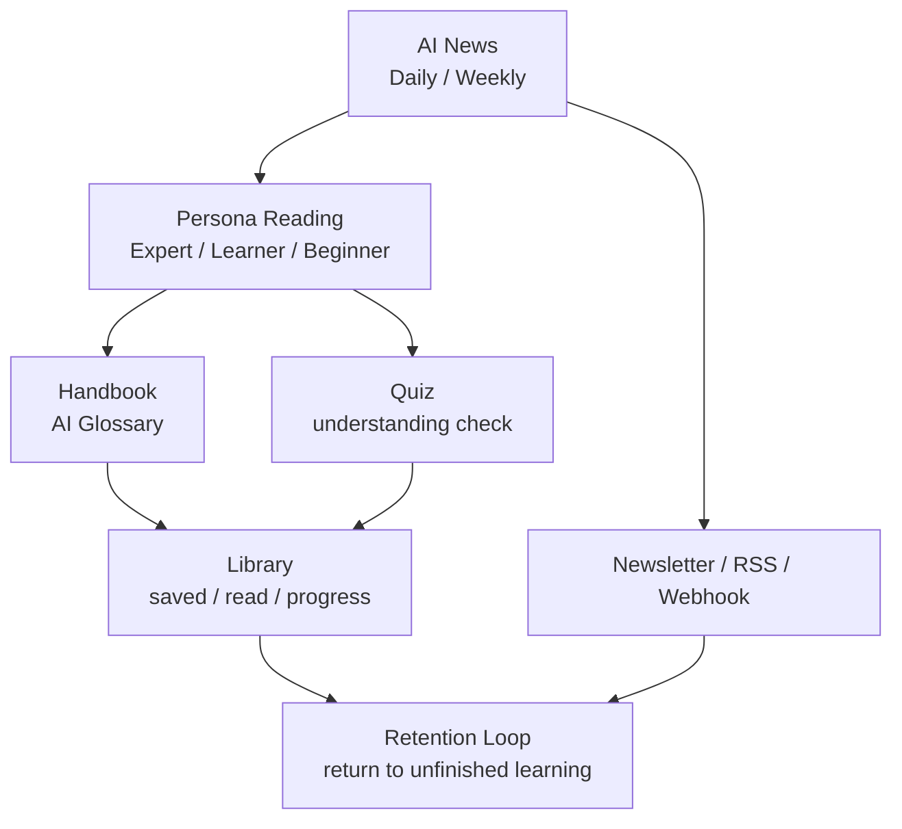

# 0to1log PM Portfolio Case Study

> 목적: 이 문서는 0to1log 프로젝트를 **PM/Product 관점의 포트폴리오 케이스 스터디**로 설명하기 위한 별도 문서다. AI 엔지니어링 구현 중심 문서는 `docs/portfolio/ai-engineering-portfolio.ko.md`, 전체 프로젝트 보고서는 `docs/0to1log-project-report.ko.md`를 참고한다.

## 1. Product Summary

0to1log는 매일 쏟아지는 AI 뉴스를 독자 수준별로 재가공해 제공하는 AI 뉴스 큐레이션 및 학습 플랫폼이다. 단순히 뉴스를 모아 보여주는 제품이 아니라, 사용자가 AI 기술 변화를 이해하고, 용어를 학습하고, 다시 찾아보고, 장기적으로 학습 기록을 쌓을 수 있도록 설계된 콘텐츠 기반 제품이다.

PM 관점에서 이 프로젝트의 핵심 포지셔닝은 다음과 같다.

> "AI 뉴스를 많이 보여주는 서비스"가 아니라, "AI 변화를 이해 가능한 학습 루틴으로 바꾸는 제품"

0to1log의 주요 product surface는 다음 네 가지다.

| Surface | 역할 |
| --- | --- |
| AI News | 매일 발생하는 AI 기술/비즈니스 뉴스를 Research/Business 관점으로 큐레이션 |
| Handbook / AI Glossary | 뉴스 이해에 필요한 AI 용어와 개념을 구조화된 학습 콘텐츠로 제공 |
| Library | 사용자의 읽기 기록, 저장한 글, 학습 진도를 모아 재방문 이유를 만드는 공간 |
| Newsletter / RSS / Webhook | 사용자가 직접 방문하지 않아도 콘텐츠 루틴을 유지할 수 있는 알림 채널 |

## 2. PM 관점에서의 한 줄 성과

0to1log에서 PM으로서 가장 강하게 어필할 수 있는 지점은 **AI 뉴스 소비 문제를 단순 요약 문제가 아니라 독자 세그먼트, 신뢰, 학습 지속성, 수익화 타이밍이 얽힌 제품 문제로 재정의했다는 점**이다.

구체적으로는 다음 판단들이 드러난다.

- 모든 사용자를 하나의 "AI 관심자"로 묶지 않고 Expert/Learner/Beginner로 나눴다.
- 뉴스 소비를 일회성 pageview가 아니라 Handbook, Quiz, Library, Newsletter로 이어지는 학습 루틴으로 설계했다.
- 수익화와 앱 확장은 빨리 붙이는 대신 정량 게이트를 통과한 뒤 진행하도록 분리했다.
- Beginner persona는 처음부터 필수 기능으로 고정하지 않고, 품질/운영 리스크를 낮추기 위해 optional layer로 도입했다.
- AI 생성 품질을 기술 지표가 아니라 사용자 신뢰와 재방문에 연결되는 제품 품질로 다뤘다.

## 3. Problem Definition

### 3.1 사용자가 겪는 문제

AI 뉴스는 빠르게 늘어나지만, 독자가 실제로 겪는 문제는 "뉴스가 부족하다"가 아니다. 오히려 문제는 다음에 가깝다.

| 사용자 문제 | 제품 관점 해석 |
| --- | --- |
| 너무 많은 AI 뉴스가 매일 쏟아진다 | 사용자는 모든 뉴스를 볼 시간이 없고, 우선순위가 필요하다 |
| 같은 사건이 여러 매체에서 반복된다 | 중복 제거와 사건 단위 병합이 필요하다 |
| 기술 용어와 배경지식이 부족하다 | 뉴스와 용어 학습이 분리되면 이해가 끊긴다 |
| 영어 원천 정보와 한국어 독자 사이에 간극이 있다 | EN canonical + KO localized 전략이 필요하다 |
| AI 뉴스 요약은 신뢰하기 어렵다 | 출처, 인용, 품질 게이트가 제품 신뢰의 핵심이다 |
| 읽고 나면 다시 찾기 어렵다 | 저장, 읽기 기록, 내 서재, 학습 진도가 필요하다 |

### 3.2 PM 문제 정의

따라서 0to1log의 PM 문제 정의는 다음과 같다.

> AI 뉴스의 양이 아니라, 독자가 매일 이해하고 따라갈 수 있는 "신뢰 가능한 학습 흐름"이 부족하다.

이 정의 때문에 제품은 단순 뉴스 피드가 아니라 아래 구조를 갖게 됐다.

- **선별**: 매일 50~60개 후보 중 발행 가치가 있는 뉴스를 선택한다.
- **맥락화**: Research/Business 관점과 community signal을 함께 본다.
- **개인화 전 단계**: Expert/Learner/Beginner 독자층에 맞춰 설명 방식을 나눈다.
- **학습 연결**: Handbook과 Quiz로 이해를 보완한다.
- **재방문 장치**: Library, reading history, bookmark, progress로 콘텐츠 소비를 누적한다.

## 4. Target Users & Segmentation

0to1log의 타겟은 "AI에 관심 있는 모든 사람"이 아니다. PM 관점에서는 아래처럼 서로 다른 needs를 가진 세그먼트로 보는 것이 더 정확하다.

### 4.1 Expert

| 항목 | 내용 |
| --- | --- |
| 사용자 | AI/ML 엔지니어, 개발자, 기술 리더, AI 업계 종사자 |
| 원하는 것 | 기술 변화의 신호, 모델/논문/오픈소스 영향, 실무 적용 가능성 |
| 싫어하는 것 | 과도하게 쉬운 설명, 배경 설명 반복, 근거 없는 시장 과장 |
| 제품 요구 | 깊이 있는 분석, 정확한 출처, technical implication |

### 4.2 Learner

| 항목 | 내용 |
| --- | --- |
| 사용자 | AI를 실무/학습에 적용하려는 개발자, PM, 데이터 직군 |
| 원하는 것 | 주요 개념 설명, 왜 중요한지, 내 프로젝트에 어떻게 연결되는지 |
| 싫어하는 것 | 용어만 나열된 요약, 너무 짧아 맥락이 사라진 글 |
| 제품 요구 | 개념 보강, action item, 관련 용어 연결 |

### 4.3 Beginner

| 항목 | 내용 |
| --- | --- |
| 사용자 | ChatGPT는 쓰지만 AI 논문/모델/인프라 용어에 익숙하지 않은 일반 지식 노동자 |
| 원하는 것 | 쉬운 언어, 용어 풀이, 왜 내 일과 관련 있는지 |
| 싫어하는 것 | "쉬운 척하지만 실제로는 expert minus jargon"인 콘텐츠 |
| 제품 요구 | 짧고 명확한 설명, Handbook 연결, 학습 부담 감소 |

### 4.4 Operator / Admin

Solo 프로젝트에서는 PM이 내부 운영자이기도 하다. 따라서 admin도 중요한 사용자다.

| 항목 | 내용 |
| --- | --- |
| 사용자 | 콘텐츠 운영자, 즉 Amy |
| 원하는 것 | 품질 확인, rerun, 비용 확인, 발행 전 검수, 문제 콘텐츠 수정 |
| 싫어하는 것 | 실패 원인을 알 수 없는 자동화, 전체 재실행 비용, 수동 검수 병목 |
| 제품 요구 | Admin editor, pipeline logs, quality score, rerun controls |

PM 관점에서 중요한 점은 "독자 경험"과 "운영자 경험"을 동시에 설계했다는 것이다. AI 콘텐츠 제품은 생성만 자동화해도 운영되지 않는다. 품질 검수, 실패 복구, 비용 확인, 재발행 흐름이 있어야 실제 제품으로 굴러간다.

## 5. Product Strategy

### 5.1 제품 전략의 중심축

0to1log의 전략은 콘텐츠를 많이 만드는 것이 아니라, 아래 네 가지 축을 연결하는 것이다.

| 전략 축 | 제품 판단 |
| --- | --- |
| Trust | AI가 만든 뉴스일수록 출처, citation, 품질 점수가 중요하다 |
| Accessibility | 독자 수준이 다르면 같은 뉴스도 다른 설명 방식이 필요하다 |
| Learning Loop | 뉴스만 읽고 끝나지 않도록 Handbook, Quiz, Library로 연결한다 |
| Sustainable Growth | 수익화/앱 확장은 트래픽과 재방문이 검증된 뒤 진행한다 |

### 5.2 제품 구조

이 구조에서 AI News는 acquisition과 activation의 입구다. Handbook은 comprehension을 보완하고, Quiz는 이해 확인과 engagement를 만든다. Library는 개인화와 retention으로 이어지는 기반 데이터가 된다.

### 5.3 Public Product Language

제품 언어도 PM 의사결정의 일부다. 내부/admin 용어와 사용자-facing 용어를 분리해 제품 인지 부담을 줄였다.

| 맥락 | 용어 |
| --- | --- |
| Public product | AI News, Handbook 또는 AI Glossary, Library |
| Internal/admin | Posts, Handbook, pipeline runs, quality scores |

이 분리는 단순 naming이 아니라, 사용자가 제품을 "블로그 관리 시스템"이 아니라 "AI 뉴스와 학습을 위한 앱"으로 인식하게 만드는 장치다.

## 6. Key Product Decisions

### 6.1 Daily Dual News: Research와 Business를 나눈 결정

AI 뉴스는 기술 변화와 시장 변화가 섞여 있다. 하나의 글에서 둘을 모두 다루면 깊이와 명확성이 떨어진다.

| 트랙 | 목적 |
| --- | --- |
| Research | 논문, 모델, 오픈소스, 기술 구조 중심의 심화 뉴스 |
| Business | Big Tech, 산업, 제품, 시장 영향 중심의 분석 뉴스 |

PM 판단:

- 사용자의 reading intent가 다르므로 콘텐츠 트랙을 나눴다.
- Research는 technical depth를, Business는 strategic implication을 우선한다.
- 이 구조는 향후 premium tier나 persona별 콘텐츠 계층화에도 연결된다.

### 6.2 Persona Switcher: 하나의 정답 콘텐츠 대신 독자별 해석

초기에는 Beginner/Learner/Expert 세분화가 있었고, 운영 복잡도를 줄이기 위해 한 시점에는 Beginner를 Learner에 통합했다. 이후 실제 Learner 콘텐츠를 honest review하면서 "expert minus jargon"에 가깝다는 문제가 발견됐고, v13에서 Beginner를 다시 별도 persona로 도입했다.

이 흐름이 PM 관점에서 중요한 이유:

- 사용자 세그먼트를 처음부터 고정된 가정으로 보지 않았다.
- 콘텐츠 품질 리뷰 결과에 따라 segmentation을 수정했다.
- Beginner를 바로 required persona로 두지 않고 optional layer로 넣어 발행 리스크를 낮췄다.

결정 구조:

| 단계 | 판단 |
| --- | --- |
| 초기 | 3 persona로 다양한 독자층을 커버하려는 가정 |
| 중간 | 운영 복잡도와 콘텐츠 일관성을 위해 Learner/Expert 중심으로 축소 |
| v13 | Learner가 실제 beginner 문제를 해결하지 못한다고 판단, Beginner를 별도 optional layer로 재도입 |

포트폴리오에서 강조할 문장:

> "페르소나는 기획서에 적힌 타겟 정의가 아니라, 실제 콘텐츠를 읽었을 때 사용자의 이해 수준과 맞는지 검증하면서 조정한 제품 변수였습니다."

### 6.3 Handbook: 뉴스와 학습을 연결하는 제품 장치

Handbook은 단순 용어 사전이 아니다. PM 관점에서 Handbook의 역할은 뉴스 소비 중 발생하는 이해 단절을 줄이는 것이다.

제품 판단:

- AI 뉴스는 용어와 배경지식을 모르면 읽다 멈추기 쉽다.
- 뉴스 글 안에서 모든 개념을 설명하면 본문이 무거워진다.
- Handbook을 별도 surface로 두면 뉴스는 흐름을 유지하고, 용어는 깊게 학습할 수 있다.
- 로그인 사용자의 저장, 읽기 기록, 학습 완료와 연결하면 장기 retention 장치가 된다.

Handbook의 PM 가치:

| 가치 | 설명 |
| --- | --- |
| Comprehension | 어려운 AI 용어를 별도 페이지에서 설명 |
| Retention | 읽은 용어, 저장한 용어, 학습 완료 기록을 만든다 |
| Personalization | handbook_level과 progress를 추천/알림에 활용 가능 |
| Quality Loop | confusing feedback을 admin 보완 우선순위로 연결 가능 |

### 6.4 Library: 로그인 이유를 만드는 기능

사용자 기능 설계에서 핵심 전략은 "로그인 발판"이었다. 단순 댓글 기능만으로는 로그인할 이유가 약하다. 반면 저장, 읽기 기록, 학습 진도는 로그인해야 얻는 개인적 효용이 분명하다.

제품 판단:

- 로그인은 커뮤니티/수익화 이전에 습관을 만들어야 한다.
- 기사와 용어를 하나의 Library에 모으면 뉴스 소비와 학습이 연결된다.
- 읽기 기록은 단순 history가 아니라 "내가 어디까지 따라왔는지"를 보여주는 학습 타임라인이다.
- 학습 진도는 progress bias를 만들 수 있다.

기능 범위:

| 기능 | 제품 목적 |
| --- | --- |
| Social Login | friction 낮은 일반 사용자 계정 생성 |
| Bookmark | 나중에 다시 볼 이유 제공 |
| Reading History | 세션 깊이와 재방문 유도 |
| Learning Progress | Handbook 기반 학습 루틴 형성 |
| My Library | 개인화된 콘텐츠 허브 |

### 6.5 Quiz: 부가 기능이 아니라 학습 루프

Quiz는 단순 재미 요소가 아니다. 0to1log에서는 뉴스 이해도를 확인하고, 향후 포인트/학습 진도/retention으로 연결할 수 있는 engagement 장치다.

PM 판단:

- 긴 AI 뉴스는 읽고 나서 이해 여부를 확인하기 어렵다.
- Quiz는 사용자가 핵심 내용을 되짚게 만든다.
- Daily/Weekly Quiz는 재방문과 streak, point system으로 확장 가능하다.
- 본문 생성과 Quiz 생성을 분리해, 퀴즈 실패가 뉴스 발행 전체를 막지 않게 했다.

제품적으로 중요한 점:

- Quiz는 "nice-to-have" UI가 아니라 retention loop의 seed다.
- 별도 pipeline으로 분리한 것은 기술 결정이면서 동시에 제품 안정성 결정이다.

### 6.6 Newsletter / RSS / Webhook: 방문을 기다리지 않는 distribution

0to1log는 웹사이트 방문만 기다리지 않고 RSS, 이메일 뉴스레터, Webhook 채널을 운영한다.

제품 판단:

- 뉴스 제품은 사용자가 매일 직접 찾아오기를 기대하기 어렵다.
- RSS와 이메일은 비로그인 사용자도 사용할 수 있는 낮은 friction 채널이다.
- Webhook은 개발자/팀 단위 소비에 맞는 차별화된 채널이다.
- Newsletter는 향후 premium funnel과도 연결될 수 있다.

## 7. Prioritization & Roadmap

### 7.1 우선순위 원칙

0to1log의 우선순위는 아래 순서로 잡는 것이 합리적이었다.

1. 콘텐츠 품질과 발행 안정성
2. 기본 SEO/분석 기반
3. 독자별 읽기 경험
4. 로그인 기반 개인화
5. 재방문/공유/추천 루프
6. 수익화
7. 앱 확장

이 순서는 "만들고 싶은 기능" 순서가 아니라, 제품 리스크를 줄이는 순서다.

### 7.2 Phase별 제품 의사결정

| Phase | 제품 목표 | PM 판단 |
| --- | --- | --- |
| Phase 1 Foundation | 앱 구조, SEO, Analytics, Auth 기반 | 측정과 배포 기반이 없으면 후속 실험이 의미 없음 |
| Phase 2 AI Core | Daily Dual News, persona content, admin editor | 핵심 가치인 AI 뉴스 품질을 먼저 증명 |
| Phase 3 User / Intelligence | Library, 추천, AARRR, share, GEO | 콘텐츠 소비를 개인화/재방문 루프로 확장 |
| Phase 4 Community / Monetization | 포인트, 커뮤니티, premium 검토 | 신뢰와 재방문이 생긴 뒤 유료화 검토 |
| Phase 5 Native App | PWA 검증 후 앱 확장 | 앱을 먼저 만들지 않고 실제 설치/유지 지표로 판단 |

### 7.3 왜 수익화를 미뤘는가

PM 관점에서 좋은 포인트는 "수익화 아이디어가 있다"가 아니라, **언제 수익화하지 않을지 결정했다**는 점이다.

문서 기준 수익화 전략:

- Phase 1~2: 수익 없음, 신뢰와 콘텐츠 축적 우선
- Phase 2 후반~3 초반: AI Products Affiliate를 첫 수익원으로 검토
- Phase 3 중반: 트래픽 검증 후 AdSense
- Phase 3~4: premium subscription 검토
- Phase 5: PWA 검증 후 native app/in-app payment 검토

Go/Hold 게이트:

| 결정 | Go 조건 |
| --- | --- |
| AdSense 신청 | 게시글 30개 이상, 오가닉 세션 3,000+, 평균 engagement time 90초+, 재방문 20%+ |
| Premium 검토 | 최근 8주 이동평균 WAU 500+, 재방문 30%+, 페르소나 전환 15%+ |
| Native App 진입 | PWA 설치율 4%+ 4주 연속, 설치자 4주 유지율 25%+, push opt-in 35%+ |
| Infra Stage B | API 300+/일, 검색 80+/일, 커뮤니티 40+/일, 재방문 25%+ 모두 충족 |

포트폴리오에서 강조할 문장:

> "수익화와 앱 확장은 만들 수 있어서 하는 것이 아니라, 신뢰/재방문/설치 지표가 확인된 뒤 진행하는 gate-based roadmap으로 설계했습니다."

## 8. MVP Scope & Trade-offs

### 8.1 Solo 프로젝트의 범위 관리

0to1log는 solo 프로젝트이기 때문에 모든 기능을 동시에 구현할 수 없다. PM 관점에서 중요한 것은 포기한 기능과 그 이유다.

| 선택 | 포기/보류 | 이유 |
| --- | --- | --- |
| AI News 품질 우선 | 커뮤니티 기능 즉시 확장 보류 | 콘텐츠 신뢰가 없으면 커뮤니티도 유지되지 않음 |
| SEO/Analytics early setup | 화려한 growth campaign 보류 | 데이터 수집은 늦게 붙이면 과거 행동을 복원할 수 없음 |
| Library 설계 | 포인트/뱃지 즉시 구현 보류 | 개인 학습 데이터가 쌓인 뒤 gamification이 의미 있음 |
| PWA 우선 | Native app 보류 | 앱 개발/유지 비용이 크고, 설치 의향 검증이 먼저 필요 |
| Affiliate 먼저 검토 | AdSense/구독 성급한 도입 보류 | 광고는 UX를 해칠 수 있고 구독은 신뢰가 필요함 |

### 8.2 품질 vs 속도

AI 뉴스 제품은 발행 속도가 중요하지만, 신뢰가 무너지면 제품 가치가 사라진다. 따라서 0to1log는 단순 자동 발행보다 품질 게이트, admin 검수, source/citation 품질을 우선했다.

PM 판단:

- 자동화는 운영 효율을 높이지만, 잘못된 자동화는 신뢰를 잃게 만든다.
- Business 뉴스는 시장 해석이 들어가므로 수동 검수 여지를 둔다.
- Quality score와 rerun은 운영자 시간을 줄이는 장치이자 제품 신뢰를 지키는 장치다.

### 8.3 Expert vs Beginner

Expert만 잡으면 콘텐츠 깊이는 강하지만 진입 장벽이 높다. Beginner만 잡으면 차별화된 분석이 약해질 수 있다. 0to1log는 이를 하나의 평균 콘텐츠로 타협하지 않고 persona별 content layer로 풀었다.

Trade-off:

| 접근 | 장점 | 한계 |
| --- | --- | --- |
| 하나의 공통 콘텐츠 | 운영 단순 | 누구에게도 충분히 맞지 않을 수 있음 |
| 완전 개인화 | 이상적 경험 | 초기 데이터와 구현 비용이 큼 |
| Persona layer | 초기 개인화 없이도 세그먼트 차이를 반영 | 생성/검수 비용 증가 |

선택:

- 초기에는 persona layer를 사용한다.
- 로그인/읽기 기록/학습 진도가 쌓이면 추천과 개인화로 확장한다.

## 9. Success Metrics

현재 포트폴리오에서는 아직 충분한 사용자 지표를 주장하기보다, 어떤 지표로 제품 판단을 하도록 설계했는지를 보여주는 것이 더 정확하다.

### 9.1 North Star 후보

0to1log의 North Star는 단순 pageview보다 아래 지표에 가까워야 한다.

> 주간 활성 학습 독자 수: 한 주 안에 AI News를 읽고, Handbook/Quiz/Library 중 하나 이상의 학습 행동을 수행한 사용자 수

이 지표가 좋은 이유:

- 뉴스 소비와 학습 행동을 함께 본다.
- 단순 유입보다 activation과 retention에 가깝다.
- Handbook, Quiz, Library의 제품 전략과 연결된다.

### 9.2 AARRR 지표

| 단계 | 제품 지표 |
| --- | --- |
| Acquisition | 오가닉 세션, SEO 유입, AI 검색 유입, newsletter 구독, RSS 구독 |
| Activation | 첫 포스트 끝까지 읽은 비율, persona 설정 완료율, 첫 bookmark, 첫 quiz 완료 |
| Retention | 재방문 사용자 비율, reading history 기반 재방문, saved content 재열람 |
| Referral | 공유 이벤트율, Highlight to Share 사용률, OG card 공유 |
| Revenue | affiliate click/conversion, AdSense RPM, premium waitlist, paid conversion |

### 9.3 콘텐츠 품질 지표

AI 뉴스 제품에서는 콘텐츠 품질 자체가 product metric이다.

| 지표 | 의미 |
| --- | --- |
| Quality score | 발행 전 콘텐츠 품질 게이트 |
| Citation coverage | 문단별 근거 충분성 |
| Source tier mix | 신뢰도 높은 소스 비중 |
| Persona fit | Expert/Learner/Beginner별 난이도 적합성 |
| Locale integrity | EN/KO 콘텐츠 품질과 자연스러움 |
| Quiz validity | 정답/보기 품질과 retry 안정성 |

### 9.4 Go/Hold 지표

PM 문서에서 특히 어필할 수 있는 부분은 gate-based decision이다.

| 결정 | 기준 |
| --- | --- |
| AdSense | 콘텐츠 30개+, 오가닉 세션 3,000+, engagement time 90초+, 재방문 20%+ |
| Premium | WAU 500+, 재방문 30%+, persona switch 15%+ |
| PWA -> Native | PWA 설치율 4%+, 설치자 4주 유지율 25%+, push opt-in 35%+ |
| Infra 상향 | API/검색/커뮤니티/재방문 기준 모두 충족 |

## 10. Execution Evidence

### 10.1 문서 기반 PM 근거

| 문서 | PM 관점 근거 |
| --- | --- |
| `docs/01_Project_Overview.md` | 타겟 오디언스, Tier별 기능, Phase roadmap |
| `docs/02_Content_Strategy.md` | 콘텐츠 훅, persona system, quiz/poll, 다국어 운영 |
| `docs/06_Business_Strategy.md` | 수익화, AARRR, SEO/GEO, 앱 확장, Go/Hold 지표 |
| `docs/08_Handbook.md` | Handbook 역할, 사용자 저장/읽기/학습 연결, feedback admin |
| `docs/IMPLEMENTATION_PLAN.md` | Phase 흐름, product language boundary, Library/Handbook/AI News surface |
| `vault/90-Archive/2026-03/plans-completed/2026-03-08-user-features-design.md` | 로그인 발판, bookmark, reading history, learning progress, Library 설계 |
| `vault/06-Business/Monetization-Roadmap.md` | 무료 -> affiliate -> AdSense -> premium -> app 수익화 순서 |
| `vault/12-Journal-&-Decisions/2026-05-11-news-pipeline-v13.md` | Beginner persona 재도입, quiz-only, audience honesty, reliability 판단 |

### 10.2 커밋 기반 실행 근거

| 커밋 | PM 메시지 |
| --- | --- |
| `82332d55` | Beginner persona를 제품 세그먼트로 확장 |
| `62fe61cd` | Beginner news quiz backfill로 학습 루프 연결 |
| `d518a95a` | Weekly beginner pipeline으로 장기 콘텐츠 루틴 확장 |
| `2404bc15` | Quiz-only generation으로 학습 기능과 발행 안정성 분리 |
| `d8b7c4cb` | Beginner rerun admin controls로 운영자 경험 보강 |
| `42aa9ed4` | incomplete daily digest recovery로 제품 발행 안정성 개선 |
| `4949e490` | Business news quality gate 강화로 신뢰도 관리 |
| `bea2d6fd` | Handbook quality remediation workflow로 학습 콘텐츠 품질 개선 |
| `1e8166aa` | Product category grid redesign으로 AI Products surface 개선 |
| `54660aa2` | Product tile polish로 상품/도구 추천 경험 개선 |
| `fc1ae911` | Admin news editor에 read-only Quiz Preview 추가 |
| `61f6dfff` | Quiz Preview 위치 조정으로 운영자 검수 흐름 개선 |

### 10.3 실행 방식에서 보이는 PM 역량

| 역량 | 근거 |
| --- | --- |
| 문제 재정의 | 뉴스 요약 -> 학습 루틴 제품으로 확장 |
| 세그먼트 설계 | Expert/Learner/Beginner와 Operator를 분리 |
| 우선순위 판단 | Foundation -> AI Core -> User -> Intelligence -> Monetization |
| 리스크 관리 | Beginner를 optional layer로 도입, 수익화/앱은 gate 뒤로 이동 |
| 데이터 사고 | GA4, Clarity, AARRR, Go/Hold metric 정의 |
| 제품 언어 | Public product language와 internal/admin language 분리 |
| 운영 설계 | admin editor, quality score, rerun controls, pipeline logs |
| 수익화 전략 | 신뢰/트래픽 검증 전 유료화 보류 |

## 11. PM Portfolio Storylines

### Story 1. 뉴스 요약이 아니라 학습 루틴으로 문제를 재정의

Problem:

- AI 뉴스는 많지만, 사용자는 무엇을 읽어야 하는지, 왜 중요한지, 어떤 용어를 알아야 하는지 모른다.

Decision:

- 제품을 단순 뉴스 피드가 아니라 AI News + Handbook + Quiz + Library로 구성했다.

Impact:

- 뉴스 소비, 개념 학습, 저장/기록, 재방문이 하나의 제품 흐름으로 연결됐다.

Interview line:

> "사용자가 필요한 것은 더 많은 뉴스가 아니라, AI 변화를 따라갈 수 있는 반복 가능한 학습 흐름이라고 봤습니다."

### Story 2. Beginner persona를 optional layer로 재도입

Problem:

- Learner 콘텐츠가 실제 초심자에게는 여전히 어려웠다.

Decision:

- 기존 Expert/Learner 발행 안정성은 유지하고, Beginner를 optional layer로 추가했다.

Impact:

- 새로운 세그먼트를 실험하면서도 기존 핵심 발행 경험의 리스크를 낮췄다.

Interview line:

> "새 세그먼트를 바로 필수 플로우에 넣지 않고 optional layer로 시작해 제품 리스크를 낮췄습니다."

### Story 3. 로그인 기능을 커뮤니티보다 먼저, Library 중심으로 설계

Problem:

- 댓글만으로는 사용자가 로그인해야 할 이유가 약했다.

Decision:

- bookmark, reading history, learning progress, Library를 로그인 가치의 중심으로 잡았다.

Impact:

- 로그인은 계정 생성이 아니라 개인 학습 기록을 보존하는 행동이 됐다.

Interview line:

> "로그인 자체를 목표로 두지 않고, 저장과 학습 기록을 유지하기 위해 자연스럽게 로그인하게 만드는 구조를 설계했습니다."

### Story 4. 수익화를 늦춘 결정

Problem:

- Solo 프로젝트에서 수익화 기능을 빨리 붙이면 UX와 신뢰를 해치거나 개발 리소스를 분산시킬 수 있다.

Decision:

- 무료 콘텐츠와 SEO/바이럴로 신뢰를 먼저 만들고, affiliate, AdSense, premium, native app을 지표 기반 gate 뒤에 배치했다.

Impact:

- 수익화 로드맵이 기능 욕심이 아니라 제품 성숙도에 맞는 단계 계획이 됐다.

Interview line:

> "수익화는 할 수 있는 시점이 아니라, 사용자가 반복적으로 돌아오는 이유가 증명된 뒤 시작해야 한다고 봤습니다."

### Story 5. AI 품질을 기술 문제가 아니라 제품 신뢰 문제로 관리

Problem:

- AI가 만든 뉴스는 출처와 정확성이 흔들리면 제품 전체 신뢰가 무너진다.

Decision:

- citation, source quality, quality score, admin review를 제품 품질 지표로 다뤘다.

Impact:

- AI generation quality가 내부 기술 구현이 아니라 사용자-facing trust metric으로 연결됐다.

Interview line:

> "AI 품질은 모델 성능 지표가 아니라 사용자가 이 제품을 다시 믿고 읽을 수 있는지의 문제였습니다."

## 12. PM Interview STAR Answers

### 질문: 이 프로젝트에서 가장 중요한 PM 판단은 무엇이었나요?

Situation:

- AI 뉴스는 많지만, 독자마다 이해 수준과 원하는 깊이가 달랐다.

Task:

- 단순 뉴스 모음이 아니라 반복 사용 가능한 제품 구조를 만들어야 했다.

Action:

- AI News, Handbook, Quiz, Library를 하나의 학습 루프로 설계했다.
- Expert/Learner/Beginner 세그먼트를 나누고, Beginner는 optional layer로 도입해 리스크를 낮췄다.
- 수익화와 앱 확장은 Go/Hold 지표 뒤로 미뤘다.

Result:

- 제품은 단순 content site가 아니라 독자 수준별 AI 학습 루틴 제품으로 정리됐다.

### 질문: 사용자 세그먼트는 어떻게 정의했나요?

Situation:

- "AI 관심자"라는 넓은 타겟은 제품 요구를 구체화하기 어려웠다.

Task:

- 콘텐츠 깊이와 UX를 결정할 수 있는 실질적 세그먼트가 필요했다.

Action:

- Expert, Learner, Beginner로 나누고 각자의 정보 밀도, 용어 설명 필요성, 콘텐츠 길이, Handbook 연결 방식을 다르게 봤다.
- Operator/Admin도 내부 사용자로 정의해 품질 검수와 rerun 경험을 설계했다.

Result:

- Persona Switcher, Beginner persona, Handbook, Quiz, Admin editor가 각각 어떤 사용자 문제를 푸는지 명확해졌다.

### 질문: 왜 수익화를 바로 하지 않았나요?

Situation:

- 콘텐츠 제품은 수익화를 빨리 붙일 수 있지만, 초기 신뢰가 약하면 광고나 paywall이 이탈 요인이 된다.

Task:

- Solo 프로젝트에서 리소스 낭비와 UX 훼손을 줄이는 수익화 전략이 필요했다.

Action:

- SEO/바이럴과 콘텐츠 축적을 먼저 두고, affiliate, AdSense, premium, native app을 단계화했다.
- 각 단계에 오가닉 세션, engagement time, 재방문, WAU, persona switch, PWA install 같은 Go/Hold 기준을 붙였다.

Result:

- 수익화가 아이디어 목록이 아니라 데이터 기반 roadmap으로 정리됐다.

### 질문: PM으로서 기술 의사결정에 어떻게 관여했나요?

Situation:

- AI 뉴스는 생성 품질이 곧 제품 신뢰로 연결된다.

Task:

- 기술 구현이 사용자 경험과 제품 지표로 이어지도록 방향을 잡아야 했다.

Action:

- citation coverage, source quality, quality score, persona fit을 제품 품질 지표로 해석했다.
- quiz-only, quality-only rerun 같은 운영 기능을 사용자-facing 품질과 발행 안정성 관점에서 봤다.

Result:

- 기술 파이프라인 개선이 단순 backend hardening이 아니라 제품 신뢰, 운영 비용, 발행 안정성 개선으로 연결됐다.

## 13. Resume / Portfolio Bullets

### 한국어

- AI 뉴스 소비 문제를 단순 요약이 아니라 독자 수준별 학습 루틴 문제로 재정의하고, AI News, Handbook, Quiz, Library를 연결한 제품 구조를 설계했다.
- Expert/Learner/Beginner 세그먼트를 정의하고, 콘텐츠 난이도와 운영 리스크를 고려해 Beginner persona를 optional layer로 도입했다.
- 로그인 기능을 댓글 중심이 아니라 bookmark, reading history, learning progress, My Library 중심으로 설계해 재방문과 개인 학습 기록의 기반을 만들었다.
- 수익화와 앱 확장을 성급히 추진하지 않고, 오가닉 세션, 재방문율, WAU, persona switch, PWA 설치율 기반의 Go/Hold 로드맵으로 정리했다.
- AI 생성 품질을 제품 신뢰 지표로 해석하고, citation, source quality, quality score, admin review를 발행 전 품질 관리 흐름에 연결했다.

### English

- Reframed AI news consumption from a summarization problem into a personalized learning routine across AI News, Handbook, Quiz, and Library.
- Defined Expert, Learner, and Beginner audience layers, introducing Beginner as an optional product layer to reduce rollout risk while expanding accessibility.
- Designed login value around bookmarks, reading history, learning progress, and My Library instead of relying on low-value account creation.
- Built a gate-based monetization and app expansion roadmap using organic sessions, returning user rate, WAU, persona switch usage, and PWA retention thresholds.
- Connected AI content quality to product trust through citation quality, source governance, quality scoring, and admin review workflows.

## 14. Product Metrics Cheat Sheet

포트폴리오나 면접에서 지표를 말할 때는 "이미 달성했다"와 "설계한 판단 기준이다"를 구분해야 한다.

### 이미 문서/로그로 말할 수 있는 것

- 매일 50~60개 AI 뉴스 후보를 다루는 pipeline
- Daily/Weekly 콘텐츠 구조
- Research/Business 트랙
- Expert/Learner/Beginner persona 구조
- Quiz-only pipeline과 Beginner persona 확장
- Handbook 품질 개선과 seed/quality workflow
- Library, bookmark, reading history, learning progress 설계
- 수익화 Go/Hold 기준 정의

### 아직 조심해야 하는 것

- 실제 MAU/WAU 성장
- retention 개선 수치
- conversion rate
- revenue
- 유료 구독 전환
- 대규모 사용자 검증

대신 이렇게 표현하는 것이 안전하다.

- "사용자 지표는 아직 검증 전이므로, PM 문서에서는 measurement plan과 Go/Hold 기준 중심으로 정리했다."
- "제품 성과 수치 대신, 어떤 제품 리스크를 어떤 순서로 줄였는지 보여준다."
- "현재 단계에서는 콘텐츠 품질, 발행 안정성, 개인화 기반 데이터 구조가 핵심 성과다."

## 15. 포트폴리오 페이지 구성 추천

실제 포트폴리오 페이지로 압축할 때는 아래 순서를 추천한다.

1. **Headline**: AI 뉴스를 독자 수준별 학습 루틴으로 바꾼 제품
2. **Problem**: 정보 과잉, 용어 장벽, 신뢰 부족, 재방문 이유 부족
3. **Users**: Expert, Learner, Beginner, Operator
4. **Solution**: AI News + Handbook + Quiz + Library
5. **PM Decisions**: persona layer, login value, delayed monetization, gate-based roadmap
6. **Evidence**: docs, commits, metrics, roadmap
7. **Lessons**: AI 제품은 prompt보다 trust, learning loop, retention design이 중요하다

## 16. 피해야 할 표현

근거가 부족한 표현:

- "사용자 retention을 개선했다"
- "수익화를 검증했다"
- "Beginner 사용자에게 product-market fit을 찾았다"
- "대규모 사용자에게 검증된 AI 뉴스 플랫폼"
- "완전 자동화된 신뢰 가능한 뉴스 서비스"

대신 쓸 표현:

- "retention을 만들기 위한 Library, reading history, learning progress 구조를 설계했다"
- "수익화는 Go/Hold 지표를 정의하고, 검증 전까지 보류하는 로드맵으로 설계했다"
- "Beginner persona를 optional layer로 도입해 접근성 실험을 시작했다"
- "AI 뉴스 제품의 신뢰를 높이기 위해 citation, source quality, quality score를 제품 지표로 다뤘다"
- "Solo 프로젝트 제약 안에서 핵심 가치 검증, 운영 안정성, 개인화 기반을 우선했다"

## 17. 최종 PM 요약문

0to1log의 PM 포트폴리오 메시지는 "혼자서 AI 뉴스 서비스를 만들었다"보다 더 구체적이어야 한다.

핵심은 AI 뉴스 소비 문제를 단순 요약이나 자동 생성 문제가 아니라, **독자 세그먼트별 이해도, 출처 신뢰, 학습 지속성, 로그인 가치, 수익화 타이밍**이 얽힌 제품 문제로 본 것이다.

이 프로젝트에서 PM으로서 보여줄 수 있는 강점은 다음이다.

- 문제를 정보 과잉에서 학습 루틴 부족으로 재정의했다.
- Expert/Learner/Beginner로 사용자를 나누고, 실제 콘텐츠 난이도 리뷰를 통해 Beginner persona를 재도입했다.
- Handbook, Quiz, Library를 통해 뉴스 소비를 장기 학습 흐름으로 확장했다.
- 로그인, 수익화, 앱 확장을 모두 지표와 단계 게이트에 연결했다.
- AI 품질을 모델 성능이 아니라 사용자 신뢰와 재방문의 문제로 다뤘다.

따라서 이 문서는 0to1log를 **AI product strategy, content product design, user segmentation, roadmap prioritization, growth metric design을 함께 다룬 PM 케이스 스터디**로 설명하는 데 가장 적합하다.
